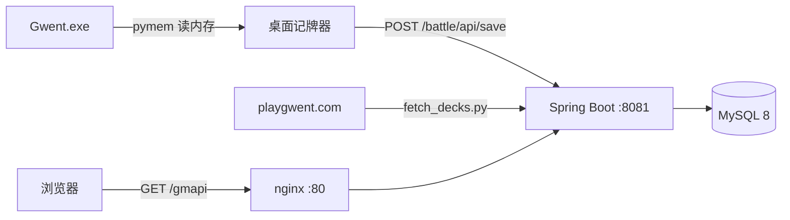

# GwentMirror · 昆特牌卡组镜像站

**打一局牌 → 记牌器把牌表传上去 → 网页上按卡牌就能搜到这套构筑。**

昆特牌玩家想找「跟我这套差三张」的牌组，只能翻论坛截图；记牌器又各管各的。
这个仓库把采集端（Windows 记牌器）、站点（Vue3）、服务（Spring Boot + MySQL）
装进**一个镜像**，`docker run` 一条命令起全套，自带真实卡组与全部卡图。

   


↑ 选牌 → 命中 15 套 → 点开看完整构筑；卡图、卡框、势力背景全部内置，不依赖官网。

## 这是什么

1. 玩家在 Windows 上开着记牌器打天梯，对局结束它把双方牌表 POST 给服务端；
2. 爬虫从官网把新卡组抓下来，**同一套牌只存一行**（按牌表哈希去重，重复出现只累加次数）；
3. 任何人打开站点，点几张牌就能列出「包含这些牌」的卡组，点开看完整构筑。

一个人也能在自己机器上跑整套：不用买服务器，不用配数据库。

## 能干什么

- **不用开游戏也能看效果** —— 容器自带 477 套样例卡组，起来就有内容
- **不靠记牌名找牌** —— 卡牌下拉 1171 张，选中的牌在结果里带橙色虚线框标出来
- **同一套牌不会重复入库** —— 牌表哈希当主键，官网反复爬到也只累加命中次数
- **采集端零配置** —— 记牌器只认一个服务端 URL，打完自动上报，单人/观战局自动跳过
- **卡图完全离线** —— 2800+ 张卡图打进前端产物，官网挂了照样渲染
- **一条命令可复现** —— MySQL + 后端 + 前端 + 反代装在一个镜像里，`docker run` 即用

## Quick Start

```bash
docker run -d --name gwent-mirror -p 8080:80 -p 8081:8081 \
  -v gwent-mysql:/var/lib/mysql \
  crpi-jjrtzj5uuz1ioat1.cn-shanghai.personal.cr.aliyuncs.com/liunidie/gwentmirror-all-in-one:1.4.0
# 等 30~60 秒（首次初始化 MySQL 并导入样例数据），然后打开 http://localhost:8080
```

不想用现成镜像？[从源码构建](docs/getting-started.md#from-source)；想改代码？[本地开发](docs/getting-started.md#本地开发不用容器)。

## 用起来是什么样

| 步骤 | 做什么 |
| --- | --- |
| 1 | 起容器，打开 <http://localhost:8080>，首屏 50 套随机卡组 |
| 2 | 点输入框选牌（如 Geralt of Rivia），列表变成「包含这些牌」的卡组 |
| 3 | 跑 `fetch_decks.py` 抓官网新卡组，或 `simulate_battle.py` 回放对局 |
| 4 | 刷新页面：新卡组进入随机列表，用卡牌检索也能命中 |

两个脚本只依赖 Python 标准库，在宿主机直接跑。详见 [docs/usage.md](docs/usage.md)。

## 怎么实现的



- **采集**：记牌器按固定偏移读游戏内存，拼出战报（牌表/回合/胜负），过滤掉旁观与友谊赛再上报
- **去重**：客户端和爬虫都用 `hash(frozenset(牌表))` 当主键，入库走 `ON DUPLICATE KEY UPDATE`
- **检索**：`LOCATE(卡牌id, cards)` 判断卡组是否包含某张牌，前端虚拟滚动只渲染可视区

细节见 [docs/architecture.md](docs/architecture.md) 与 [docs/database.md](docs/database.md)。

## 部署方式

| 方式 | 命令 | 适用 |
| --- | --- | --- |
| 现成镜像（推荐） | `docker run ...`（见上） | 只想看效果 |
| compose 构建 | `docker compose up -d --build` | 改代码后重跑 |
| 源码开发 | `mvn spring-boot:run` + `npm run dev` | 二次开发 |

镜像在阿里云上海（个人版 ACR）：`liunidie/gwentmirror-all-in-one:1.4.0`，
推送与重建见 [docs/docker.md](docs/docker.md)。

## 文档

| 文档 | 内容 |
| --- | --- |
| [getting-started](docs/getting-started.md) | 环境要求、三种启动方式、自检命令 |
| [usage](docs/usage.md) | 五步流程、爬虫/回放脚本、桌面界面复现 |
| [architecture](docs/architecture.md) | 数据流、目录结构、桌面端为什么不进容器 |
| [database](docs/database.md) | 7 张表、指纹去重、战报四表事务、常用 SQL |
| [api](docs/api.md) | 接口清单与报文样例 |
| [docker](docs/docker.md) | 构建层次、进程模型、环境变量、推送阿里云 |
| [changes](docs/changes.md) | 相对上游修的 9 处问题 |
| [troubleshooting](docs/troubleshooting.md) | 起不来/图片裂/抓不到数据/推送失败 |
| [screenshots](docs/screenshots.md) | 6 张截图与动图 |

## 说明

- 三个原始仓库（[记牌器](https://github.com/1053278842/GwentWanHuaMirror)、[服务](https://github.com/1053278842/GwentMirrorService)、[站点](https://github.com/1053278842/GwentMirror)）版权归原作者；
  本仓库只做容器化整合、启动编排、缺陷修复与文档整理。
- 截图与动图都来自真实运行（`docker run` + `desktop/gui_demo.py`），不是设计稿。
- 卡组数据来自官网公开接口，仅做展示与检索。

<details>
<summary>English</summary>

**Play a match → the tracker uploads both decks → search the site by card.**

GwentMirror packs a Windows card tracker, a Vue 3 deck site and a Spring Boot + MySQL service
into a single `docker run` container, seeded with 477 real decks and fully offline card art.

```bash
docker run -d -p 8080:80 -p 8081:8081 -v gwent-mysql:/var/lib/mysql \
  crpi-jjrtzj5uuz1ioat1.cn-shanghai.personal.cr.aliyuncs.com/liunidie/gwentmirror-all-in-one:1.4.0
```

Open <http://localhost:8080>. Docs: [getting-started](docs/getting-started.md) ·
[architecture](docs/architecture.md) · [api](docs/api.md).

</details>