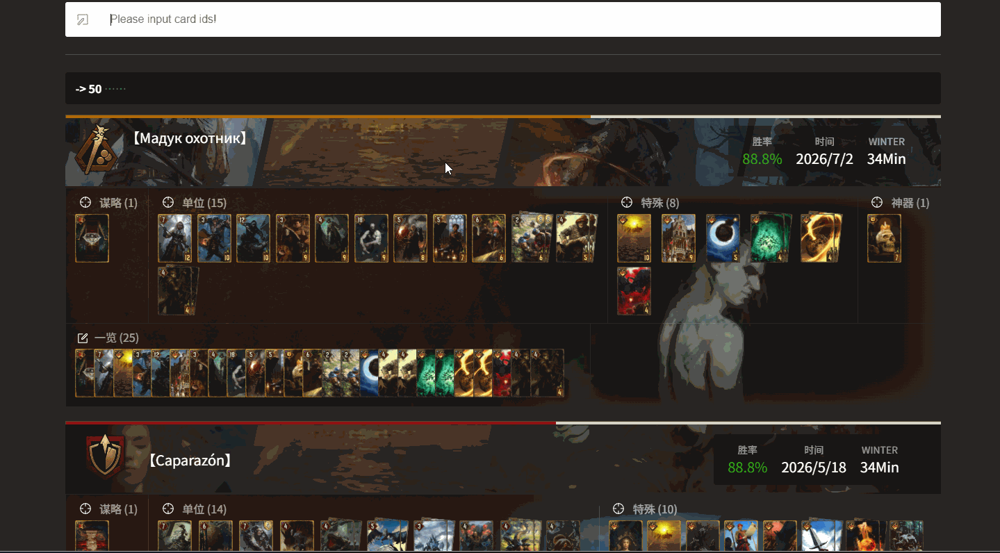
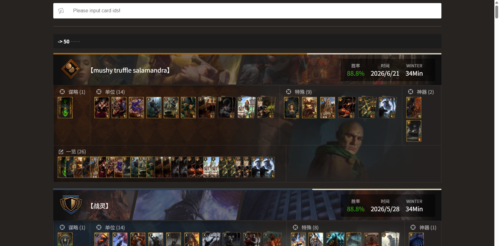
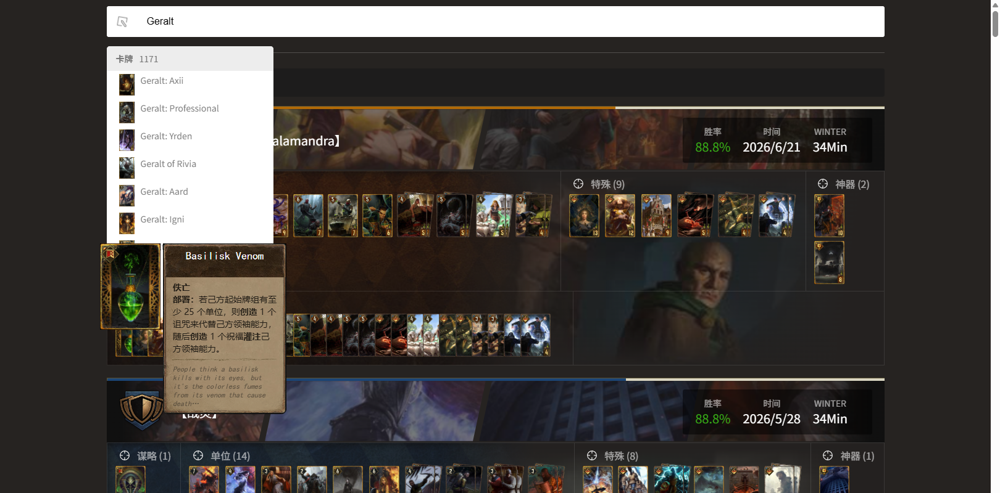
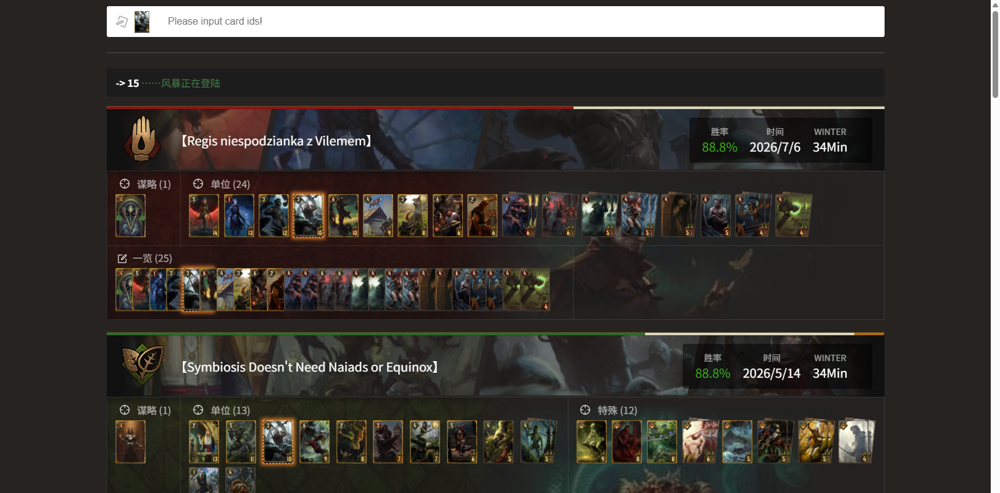
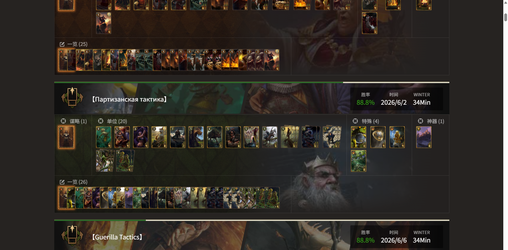
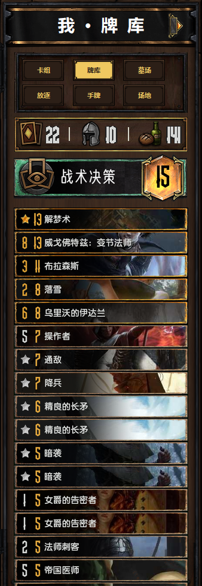
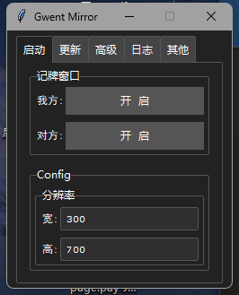

# GwentMirror · 巫师之昆特牌 卡组镜像站（一体化容器）

把三个独立仓库合并成**一个可以直接 `docker run` 起来的容器**：
Windows 桌面记牌器（采集端）+ Vue3 卡组网站（前端）+ Spring Boot 服务（后端）+ MySQL（存储）。
本地起容器就能复现前端页面、对局上报和官网卡组抓取脚本的完整效果。

| 原仓库 | 作用 | 在本项目中的位置 |
| --- | --- | --- |
| [GwentWanHuaMirror](https://github.com/1053278842/GwentWanHuaMirror) | Windows 桌面「昆特记牌器」：`pymem` 读游戏进程内存，识别双方牌表，对局结束后把战报 POST 给服务端；附带官网卡组抓取脚本 | `desktop/`、`scripts/` |
| [GwentMirrorService](https://github.com/1053278842/GwentMirrorService) | Spring Boot 2.6.3 + MyBatis-Plus + MySQL：接收战报/卡组入库，对外提供卡组查询 API | `backend/` |
| [GwentMirror](https://github.com/1053278842/GwentMirror) | Vue3 + Vite + Element Plus 卡组网站：按卡牌组合检索卡组、卡组详情、悬浮卡牌预览 | `frontend/` |

卡组站实拍（选牌 → 过滤 → 卡组详情，42 帧）：



---

## 1. 快速启动

### 1.1 直接跑已构建好的镜像

```bash
docker run -d --name gwent-mirror \
  -p 8080:80 -p 8081:8081 \
  -v gwent-mysql:/var/lib/mysql \
  crpi-jjrtzj5uuz1ioat1.cn-shanghai.personal.cr.aliyuncs.com/liunidie/gwentmirror-all-in-one:1.4.0
```

浏览器打开 <http://localhost:8080>（会自动跳到卡组检索页 `/search`）。
后端 API 直连地址 <http://localhost:8081>。

* 首次启动约 **30~60 秒**：初始化 MySQL 数据目录 → 导入 `backend/GwentMirror.sql`（7 张表 + 477 个样例卡组）→ 拉起后端与 nginx。
* 健康检查：`curl http://localhost:8080/healthz` 返回 `ok`；容器状态显示 `healthy`。
* 端口被占用时把 `-p 8080:80` 换成别的宿主机端口即可（例如 `-p 18080:80`）。

### 1.2 docker compose（含构建）

```bash
docker compose up -d --build
docker compose logs -f
```

### 1.3 从源码自己构建

```bash
./scripts/build.sh                              # 默认 tag gwentmirror-all-in-one:1.0.0
IMAGE=myrepo/gwent:dev ./scripts/build.sh       # 自定义 tag
```

构建是三层多阶段：`maven` 编 jar → `node` 编前端 → `ubuntu 22.04` 装 MySQL8/nginx/JRE11 组装运行镜像。

### 1.4 端口、目录与默认账号

| 端口 | 说明 |
| --- | --- |
| **8080 → 80** | nginx：前端静态站点、`/gmapi/` 反代后端、`/healthz` |
| **8081 → 8081** | Spring Boot：`/deck/api/*`、`/battle/api/*`、`/version/api/*` |

| 环境变量 | 默认值 | 说明 |
| --- | --- | --- |
| `GWENT_DB_NAME` | `GwentMirror` | 数据库名 |
| `GWENT_DB_USER` / `GWENT_DB_PASS` | `gwent` / `gwent123` | 后端连接账号 |
| `JAVA_OPTS` | `-Xms256m -Xmx512m` | JVM 参数 |
| `TZ` | `Asia/Shanghai` | 时区 |

MySQL 只监听容器内 `127.0.0.1:3306`，不对外暴露。需要连库时：

```bash
docker exec -it gwent-mirror mysql -ugwent -pgwent123 GwentMirror -e "select count(*) from deck;"
```

---

## 2. 界面截图

**卡组检索首页**：顶部卡牌检索栏 + 随机推荐的 50 套近期卡组，每个卡组按 谋略/单位/特殊/神器 分组展示。



**卡牌检索栏 + 悬浮卡牌详情**：点输入框展开卡牌下拉（虚拟列表），鼠标悬停任意卡牌会浮出带技能描述的大图。
注意卡牌名/技能来自内置 `allCard.json`，卡面素材来自 `/src/assets/card/`，全程不依赖官网接口。



**按卡牌过滤卡组**：选中「Geralt of Rivia」后，顶部显示命中数量（`-> 15`），
每个卡组的「一览」里被选中的那张牌会带橙色虚线边框。



**卡组详情**：按 谋略 / 单位 / 特殊 / 神器 分组，底部「一览」按人口降序排；背景是该势力的原画。



### 2.1 桌面记牌器（GwentWanHuaMirror）

对局中常驻的**透明置顶悬浮窗**：标题是当前页签（我·牌库 / 我·卡组 / 手牌 / 墓场…），
第二行是页签按钮，第三行是统计（剩余张数 / 单位数 / 总人口），
再往下是领袖卡与整副牌逐张排列（卡图 + 人口 + 战力 + 稀有度），新出现的牌会有高亮描边。



主控制窗（启动/更新/高级/日志/其他，含记牌窗开关与分辨率设置）：



> 这两张是用 `desktop/gui_demo.py` 在本机**实际渲染**出来的：界面代码、
> 资源图（`GwentImg_preview` / `deck_preview`）、字体全部走仓库原始实现，
> 只把「读 Gwent.exe 进程内存」这一层换成了替身数据源（见 3.1 与 11 节）。

---

## 3. 整体架构

```text
                       ┌────────────────────────── 容器 gwent-mirror ──────────────────────────┐
                       │                                                                       │
  Windows 游戏 ────────┤ desktop/main (Python 记牌器)                                          │
   Gwent.exe           │   pymem 读内存 → battleInfo → POST /battle/api/save ─┐                │
                       │                                                       │                │
  官网 playgwent.com ──┤ scripts/fetch_decks.py → POST /deck/api/post ─────────┤                │
                       │                                                       ▼                │
                       │   nginx :80                                  ┌───────────────────────┐ │
  浏览器 ──── HTTP ────►│   ├─ /          → Vue3 静态站点 (SPA)        │ Spring Boot :8081     │ │
                       │   ├─ /gmapi/*   → 127.0.0.1:8081             │  /deck/api/*          │ │
                       │   ├─ /api-pg/*  → www.playgwent.com (备用)   │  /battle/api/*        │ │
                       │   └─ /healthz                                │  /version/api/*       │ │
                       │   /src/assets/card/...（2800+ 卡图素材）      └──────────┬────────────┘ │
                       │                                                        │ JDBC           │
                       │                                              ┌─────────▼────────────┐  │
                       │                                              │ MySQL 8 (127.0.0.1)  │  │
                       │                                              └──────────────────────┘  │
                       └───────────────────────────────────────────────────────────────────────┘
```

容器内由 `supervisord` 托管三个进程：`mysqld` → `gwent-service`(Java) → `nginx`；
`docker/entrypoint.sh` 只在**首次启动**时建库、建账号、导入 SQL，然后 `exec supervisord`。

### 3.1 桌面端为什么不在容器里

记牌器不是"读日志"而是**读进程内存**：`pymem.Pymem("Gwent.exe")` 附加进程 →
用 `GameAssembly.dll` 基址 + 版本表里的偏移一路解引用 → 拿到 `GameInstance` →
再按偏移读出双方玩家、牌表、每张牌的位置/战力/人口。它只能在 Windows 上、且游戏正在运行时工作，
所以：

* 容器里只放**服务端 + 前端**，桌面端源码留在 `desktop/` 供 Windows 侧使用；
* 桌面端与服务器之间只靠 HTTP 通信（`/battle/api/save`、`/deck/api/getDecks`、`/version/api/getId`），
  协议由 `scripts/simulate_battle.py` 完整复现，因此容器里也能演示"上报 → 入库 → 前端可见"的完整链路；
* 桌面端的**图形界面**用 `desktop/gui_demo.py` 做离线复现（见 6.4），
  只替换内存读取层，界面渲染代码与素材全部是原版。

---

## 4. 目录结构

```text
gwent-mirror-all/
├─ backend/                    # GwentMirrorService：Spring Boot 2.6.3 + MyBatis-Plus
│  ├─ src/main/java/com/ll/gwentmirror/
│  │  ├─ controller/           # DeckController / BattleController / VersionController / FileController
│  │  ├─ service/impl/         # 入库、分页、版本增量
│  │  ├─ mapper/ + resources/mapper/*.xml      # 手写 SQL（批量插入、包含匹配）
│  │  └─ utils/BeansUtils.java # 客户端 JSON → 实体（核心转换）
│  └─ GwentMirror.sql          # 表结构 + 477 个样例卡组（容器首启导入）
├─ frontend/                   # GwentMirror：Vue3 + Vite + Element Plus
│  └─ src/
│     ├─ api/gwentmirror.ts    # 后端调用（统一走 /gmapi 前缀）
│     ├─ stores/AllCards.ts    # allCard.json → 卡牌对象（离线可用）
│     ├─ views/DeckSearchView.vue  # 首页：卡牌检索 + 卡组虚拟滚动列表
│     ├─ views/DeckView.vue        # 单个卡组：分组、势力背景
│     ├─ views/CardView.vue        # 单张卡牌渲染（含悬浮大图）
│     └─ assets/card/…         # 2800+ 卡图/卡框/数字图标
├─ desktop/                    # GwentWanHuaMirror：Python 记牌器（Windows 专用）
│  ├─ gui_demo.py              # 离线复现图形界面并截图（替换内存层，不用开游戏）
│  └─ main/
│     ├─ GwentMirror.py        # 主控制窗（ttkbootstrap）
│     ├─ GwentGUI.py           # 对局内透明置顶悬浮窗
│     ├─ views/                # 背景板 / 标题栏 / 页签按钮 / 状态栏 / 卡牌列表五个画布
│     ├─ dao/services          # 内存寻址与卡牌数据装配
│     ├─ resources/images/     # deck_preview（UI 切图）+ GwentImg_preview（1369 张卡图缩略图）
│     └─ resources/fonts/      # 界面用的中文字体
├─ docker/                     # Dockerfile / nginx.conf / supervisord.conf / entrypoint.sh / my.cnf
├─ scripts/                    # build.sh / push-aliyun.sh / demo.sh / fetch_decks.py / simulate_battle.py
└─ docs/screenshots/           # README 截图（前端 4 张 + 桌面端 2 张）
```

三个子目录各有一份自己的 README（`backend/`、`frontend/`、`desktop/`），
分别说明这一层做什么、怎么单独跑、和一体化容器怎么对接。

---

## 5. 核心逻辑

### 5.1 数据模型（`backend/GwentMirror.sql`）

| 表 | 说明 |
| --- | --- |
| `deck` | 卡组。`cards` 是逗号分隔的卡牌 id 串（客户端/爬虫上报的原始形态）；`id` = 卡组指纹；`deck_web_id` = 官网卡组 id；`total` = 命中次数 |
| `player` | 玩家，`service_id` 为主键，重复出现时 `repeated_times + 1` |
| `battle` | 一场对局：`game_id`、模式、结束原因、左右两条 `player_battle_info` |
| `player_battle_info` | 单侧战报：牌表 id、胜负、逐回合小分（JSON） |
| `card` | 卡牌缓存表（前端已改用 `allCard.json`，此表保留兼容） |
| `version` | 版本水位线，`/version/api/getId` 用它判断客户端卡组库是否要更新 |
| `other` | 杂项键值（运维用） |

### 5.2 卡组指纹：同一套牌只存一行

客户端和爬虫都用「牌表集合的哈希」当主键，与出牌顺序无关：

```python
# desktop/main/tools/DataUtils.py
def transListCtIdToHash(decks):
    return hash(frozenset(decks))
```

入库统一走 `INSERT ... ON DUPLICATE KEY UPDATE`（`DeckMapper.xml`）：

```sql
INSERT INTO deck (...) VALUES (...)
ON DUPLICATE KEY UPDATE
  total  = total + 1,                                       -- 命中次数 +1
  name   = IF(time < VALUES(time), name,   VALUES(name)),    -- 只接受更新的版本
  author = IF(time < VALUES(time), author, VALUES(author)),
  time   = IF(time < VALUES(time), time,   VALUES(time));
```

同一套牌被不同玩家反复打出、或在官网反复爬到，只会让 `total` 增长并刷新最新的名称与时间，表不会膨胀。

### 5.3 桌面记牌器 → 服务端

`desktop/main/dao/CardDao.py:getBattleInfo()` 按固定偏移读游戏内存，拼出：

```jsonc
{
  "GameStatus": 3, "GameMode": 1, "GameId": 1732..., "BattleType": 2,
  "roundInfos": [{ "index": 0, "left_score": 12, "right_score": 8,
                   "starting_playerId": 1, "winner_playId": 1, "turn_index": 11 }, ...],
  "curr_round_index": 2, "winner_playId": 1, "end_game_reason": 0,
  "players": [
    { "player_name": "...", "service_id": 900000000000000001, "paragon_level": 0,
      "MMR": 9600, "rank": 0,
      "leader_id": 200087, "stratagem_id": 0, "faction_id": 4,
      "decks": [200087, 0, 202115, 201779, ...],   // leader + stratagem + 牌表
      "deckId": 1234567890123456789 }              // hash(frozenset(decks))
  ]
}
```

`RequestManager.sendBattleInfo()` 先做过滤：局内未结束、单人/观战模式、友谊赛/竞技场一律不上报；
「自动提交卡组」关闭时把 `decks` 清空（只统计对局、不采集牌表）。通过后 `POST /battle/api/save`。

服务端 `BeansUtils` 把这份 JSON 拆成 `player` / `deck` / `battle` / `player_battle_info` 四类实体，
由 `BattleServiceImpl.saveBattleInfo()` 在**一个事务**里写完：
先插 battle 拿主键 → 两个 pbi 插入拿 id → 回填 battle 的左右 id。

### 5.4 官网爬虫 → 服务端

`scripts/fetch_decks.py`（源自 `desktop/main/othersFile/抓取卡组-官网.py`，改成纯命令行 + 线程池）：

1. `GET /deck/api/maxid` 拿到库内已有的最大官网卡组 id；
2. 拉官网 `guides/offset/0000/limit/500` 列表，筛出时间窗内且 id 更新的卡组；
3. 逐个拉详情，把 `srcCardTemplates` 拍平成 `sortedCtIds`，换算势力 id（monsters=2 / nilfgaard=4 / northernrealms=8 / scoiatael=16 / skellige=32 / syndicate=64）；
4. 批量 `POST /deck/api/post`。

### 5.5 前端检索

* 卡牌数据打包进 `src/assets/allCard.json`（1171 张），**不依赖官网接口**，离线也能渲染名称、战力、护甲、人口与卡图。
* 选卡 → `stores/UserOperationStore` 累积 card id → `GET /gmapi/deck/api/getDecksByIds?ids=...`。
  后端 `DeckMapper.getListByIds` 用 `LOCATE(#{cid}, cards) > 0 OR stratagem_card_id = #{cid}`
  做「卡组里包含这些牌」的匹配，按 `update_time` 倒序。
* 未选牌时走 `GET /gmapi/deck/api/getRandomDecksLast?num=50`：取 `create_time` 晚于最新版本水位的卡组，随机 50 个作为首屏推荐。
* 列表用 `vue-virtual-scroller` 的 `DynamicScroller` 做虚拟滚动，单页 1000px 高度内滚动加载，避免一次渲染上千个卡组。
* 卡图/CSS 在代码里是以 `/src/assets/...` **绝对路径**引用的，所以镜像把源码目录 `src/assets` 原样发布到
  `/usr/share/nginx/html/src/assets`，构建产物（js/css）也落在同一目录，路径与开发态完全一致。

---

## 6. 脚本演示（脚本效果）

容器起来后，宿主机直接跑（只依赖 Python 标准库）：

```bash
python3 scripts/fetch_decks.py   --base-url http://localhost:8080/gmapi --since-days 30 --limit 20
python3 scripts/simulate_battle.py --base-url http://localhost:8080/gmapi --matches 3 --unique-decks
```

`/gmapi`（经 nginx 反代，和浏览器同源，最贴近真实链路）与 `:8081`（直连后端）两个入口都可以。

### 6.1 抓官网卡组

```text
[crawl] 目标服务 : http://localhost:18080/gmapi
[crawl] 时间范围 : 最近 30 天
[crawl] 库内最大官网卡组 id: 406954
[crawl] 发现 20 个新卡组，开始抓取详情 ...
  +   408945  Ursine Ritual                             27 张  faction=32
  +   408946  Renfri                                    27 张  faction=32
  +   408953  Fome Opressora                            27 张  faction=2
  +   408935  Waylay trap disco sensation               27 张  faction=16
  +   408943  調和デッキ                                     27 张  faction=16
  ...
[crawl] 详情抓取完成: 20/20
[crawl] 已批量写入服务端: 20 个卡组
```

### 6.2 回放对局（等价于记牌器上报）

```text
[replay] 目标服务: http://localhost:18080/gmapi
[replay] 取到 50 个种子卡组，开始回放 3 场对局 ...
[replay] #1 gameId=1795512708437 GwentMirror_Demo_A vs GwentMirror_Demo_B -> 胜者 player1
[replay] #2 gameId=1795512708691 GwentMirror_Demo_A vs GwentMirror_Demo_B -> 胜者 player2
[replay] #3 gameId=1795512708941 GwentMirror_Demo_A vs GwentMirror_Demo_B -> 胜者 player1
[replay] 完成: 3/3 条上报成功
```

`--unique-decks` 会把玩家 A 的牌表换掉两张牌，得到一个新的卡组指纹——
对应「玩家自己组的牌」，前端能直接搜到这张新卡组（`name = By.<玩家名>`）。

### 6.3 落库结果

```text
+---------------------+----------+
| tbl                 | n        |
+---------------------+----------+
| deck                | 497      |   -- 477 样例 + 19 条官网新卡组 + 1 条回放产生的 By.*
| battle              | 8        |   -- /battle/api/save 写入
| player              | 6        |   -- service_id 去重
| player_battle_info  | 16       |   -- 每场两条（左右各一）
| version             | 1        |
+---------------------+----------+
```

`battle` 里能看到一场对局把左右两条 `player_battle_info` 串了起来：

```text
id  game_id         game_status  game_mode  game_battle_type  left_pbi  right_pbi
1   1795512379954   3            1          2                 1         2
2   1795512380477   3            1          2                 3         4
```

### 6.4 桌面记牌器界面复现

记牌器启动时先 `pymem.Pymem("Gwent.exe")` 附加进程，取不到就直接弹「检测到游戏未启动」并退出，
所以在没有游戏的机器上跑不起来。`desktop/gui_demo.py` 的做法是**只换掉内存读取层**：

| 层 | 处理 |
| --- | --- |
| `pymem` | 注入一个假模块（`read_longlong`/`read_bytes` 全返回 0），避免附加进程 |
| `services.CardService.get_all_cardTemplates()` | 换成「从 `resources/data/decks.json` 挑一副完整卡组摊平」的替身 |
| 联合信息（当前玩家 / 双方 playerId / 牌库实例 id 区间） | 固定值 |
| `GwentGUI` / `views/*`（背景板、标题、页签、状态栏、卡牌列表） | **原样使用** |
| 素材（`deck_preview/*.png`、`GwentImg_preview/*.jpg`、字体） | **原图** |

所以截出来的就是真实界面（2.1 节那两张）。

```bash
cd desktop
pip install pillow ttkbootstrap pywin32        # tkinter 随 Python 自带
python gui_demo.py --target both               # 主窗 + 悬浮窗各截一张
python gui_demo.py --target overlay --tab 手牌  # 指定页签：卡组/牌库/墓场/放逐/手牌/场地
python gui_demo.py --target overlay --enemy     # 敌方视角
```

截图默认写到 `docs/screenshots/`；`--out-dir` 可改。
悬浮窗本身是 `overrideredirect + WS_EX_LAYERED` 的透明窗口，脚本会先垫一层深色背景再截图，
避免把桌面/浏览器一起拍进去。

---

## 7. 接口清单

| 方法 | 路径 | 说明 |
| --- | --- | --- |
| GET | `/deck/api/getDecks` | 取最多 5000 个卡组（客户端本地卡组库同步用） |
| GET | `/deck/api/getDecksByIds?ids=1,2,3&page=0` | 按包含的卡牌检索卡组，`page=0` 不分页 |
| GET | `/deck/api/getRandomDecksLast?num=50` | 版本水位之后的最新卡组，随机取 N 个 |
| GET | `/deck/api/maxid` | 库内最大的官网卡组 id（爬虫增量用） |
| POST | `/deck/api/post` | 批量写入爬虫卡组（`List<DeckJson>`） |
| POST | `/battle/api/save` | 接收记牌器战报 |
| POST | `/version/api/getId` | 返回当前版本记录（客户端判断是否更新卡组库） |
| GET | `/download` `/upload` `/good` | 客户端安装包下载/上传/探活（历史遗留） |

浏览器侧统一走 `/gmapi/*`，由 nginx 去掉前缀转发到 8081。

---

## 8. 数据卷与重置

```bash
docker volume inspect gwent-mysql            # 数据在命名卷里，重启容器不丢
docker rm -f gwent-mirror && docker volume rm gwent-mysql   # 回到初始样例数据
```

不挂 `-v` 时数据存在容器可写层，删容器即清空。

---

## 9. 阿里云镜像

镜像已推送到阿里云容器镜像服务（上海 · 个人版 ACR）：

```text
crpi-jjrtzj5uuz1ioat1.cn-shanghai.personal.cr.aliyuncs.com/liunidie/gwentmirror-all-in-one:1.4.0
digest: sha256:4a0a2b76c963f652124b5e66508e8602b242fd9bc283b6209b02eded24b1ef87
size  : 1.06 GB
```

控制台：<https://cr.console.aliyun.com/cn-shanghai/instance/repositories>

已用「推上去 → 删本地 tag → 从仓库重新 pull → 起容器」的方式验证过：
`docker pull` 拿到的 digest 与推送一致，容器 `healthy`，`/gmapi/deck/api/getDecks` 返回 477 条样例卡组，
`fetch_decks.py` / `simulate_battle.py` 对这份线上镜像同样能跑通。

重新推送：

```bash
# 用户名填阿里云账号全名，密码填 ACR 的「固定密码」
docker login --username=<阿里云账号全名> crpi-jjrtzj5uuz1ioat1.cn-shanghai.personal.cr.aliyuncs.com

./scripts/push-aliyun.sh          # = docker tag + docker push
```

`scripts/push-aliyun.sh` 支持 `REGISTRY / NAMESPACE / REPO / TAG / LOCAL_IMAGE` 环境变量覆盖，
默认命名空间 `liunidie`、仓库 `gwentmirror-all-in-one`。

> 若 push 报 `denied: requested access to the resource is denied`：先确认已登录该 registry，
> 且路径第一段是控制台里**已存在**的命名空间（个人版要先建命名空间 + 仓库，不会自动创建）。

---

## 10. 本地开发（不用容器）

```bash
# 后端：JDK8+ 与本地 MySQL，改 application.yml 的 datasource
cd backend && mvn spring-boot:run

# 前端：/gmapi 与 /localapi 都指向 localhost:8081
cd frontend && npm install && npm run dev
```

`frontend/vite.config.ts` 里 `/gmapi` 默认指向作者的线上环境（`117.50.175.251:8081`），
本地调试改成 `http://localhost:8081` 即可（或直接用 `/localapi` 前缀）。

---

## 11. 整合时修掉的上游缺陷

为了让三个仓库真的能跑起来，动了几处源码（都在 README 里标明原因，方便回溯）：

| 文件 | 问题 | 处理 |
| --- | --- | --- |
| `frontend/src/views/CardSearchView.vue` | HEAD 版本误把整个 `DeckSearchView` 页面复制了过来，还 `import` 了它自己（组件自我嵌套），首页顶部会无限嵌套渲染、整页元素重叠 | 恢复为提交 `710ddc1` 中的原始「卡牌检索栏」实现 |
| `frontend/src/views/DeckSearchView.vue` | 模板多了一个 `</template>`，`vite build` 直接失败（`Element is missing end tag`） | 删除多余结束标签 |
| `frontend/src/views/DeckSearchView.vue` | `loading` 只置 `true` 从不置 `false`，全屏 LOADING 遮罩会永久盖住页面 | 数据到达/请求失败时关闭遮罩 |
| `frontend/src/views/CardView.vue` | 20 处 `url("src/assets/...")` 少了开头的 `/`，生产环境被解析成 `/src/assets/src/assets/...` 全部 404 | 统一改为 `url("/src/assets/...")` |
| `frontend/index.html` | `lang="en"` 会触发浏览器自动翻译，卡牌英文原文本被机器翻译破坏 | 改 `lang="zh-CN"` + `translate="no"` |
| `frontend/src/assets/main.css` | Vue 模板没重置 `body` 默认外边距，铺满视口时露出一圈白边 | 追加 `html,body{margin:0}` 等容器化补充样式 |
| `backend/.../entity/Deck.java` | `cardList` 是运行期派生字段，MyBatis-Plus 却当成 `card_list` 列查，`/deck/api/getDecks` 全部 500 | 加 `@TableField(exist = false)` |
| `backend/.../controller/DeckController.java` | `getRandomDecksLast` 用 `sorted((a,b) -> new Random().nextInt())` 当比较器，违反 TimSort 契约，数据一多就抛 `Comparison method violates its general contract!` → 500 | 改成先转 DTO 再 `Collections.shuffle` |
| `backend/.../mapper/PlayerMapper.xml` | MySQL 8.0.2 起 `RANK` 是保留字，插入玩家时 SQL 语法错误，`/battle/api/save` 全链路 500 | 给 `rank` 加反引号 |

---

## 12. 已知限制

* `desktop/` 的记牌器依赖 Windows + `pymem` 读 `Gwent.exe` 内存，**不能在 Linux 容器里跑**；
  镜像只打包服务端与前端，桌面端源码保留给 Windows 侧使用，其上报协议由 `scripts/simulate_battle.py` 完整复现，
  界面由 `desktop/gui_demo.py` 离线复现（只替换内存层，见 6.4）。
* `desktop/main/resources/images/` 只带了界面必需的 `deck_preview`（57 张 UI 切图）和
  `GwentImg_preview`（1369 张卡图缩略图），**没有**带 `GwentImg原图`（约 300 MB 高清原画）；
  需要原图时用 `desktop/main/othersFile/从gwent获取图片.py` 重新抓。
* 前端 `/api-pg/*` 反代到官网，容器无外网时该路由不可用；前端卡牌数据已内置，不影响页面渲染。
* 前端 `npm run build` 会先跑 `vue-tsc` 类型检查，历史代码有类型报错，所以镜像只执行 `vite build`。
* 官网 `playgwent.com` 随时可能下线，届时 `fetch_decks.py` 不可用，但容器自带 477 个样例卡组仍可完整演示。
* 卡组列表用虚拟滚动 + 变高估算，窗口尺寸剧变时偶发滚动位置错位，刷新即恢复（原实现如此）。
* 桌面端主窗原始 geometry 是 250×280，启动页内容比它高（「分辨率」第二行会被裁掉）；
  `gui_demo.py` 截图时宽度保持 250、高度按内容自适应，所以你看到的是完整布局。

---

## 13. 致谢

原始项目与代码版权归 [@1053278842](https://github.com/1053278842) 所有；
本仓库只做容器化整合、启动编排、缺陷修复与文档整理。