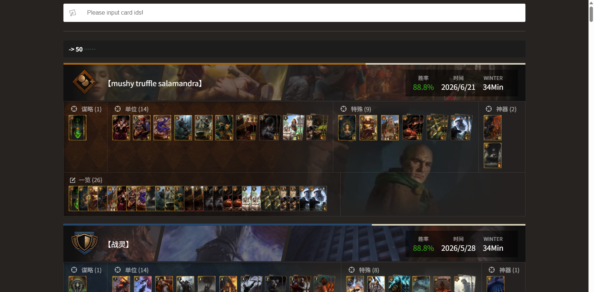
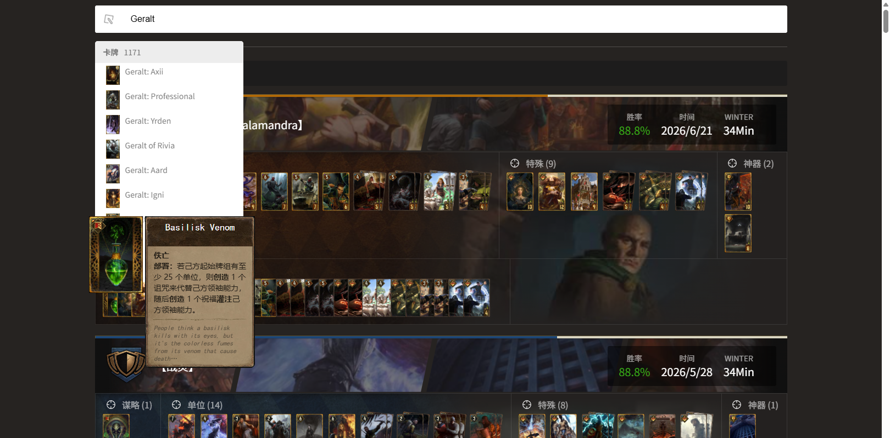
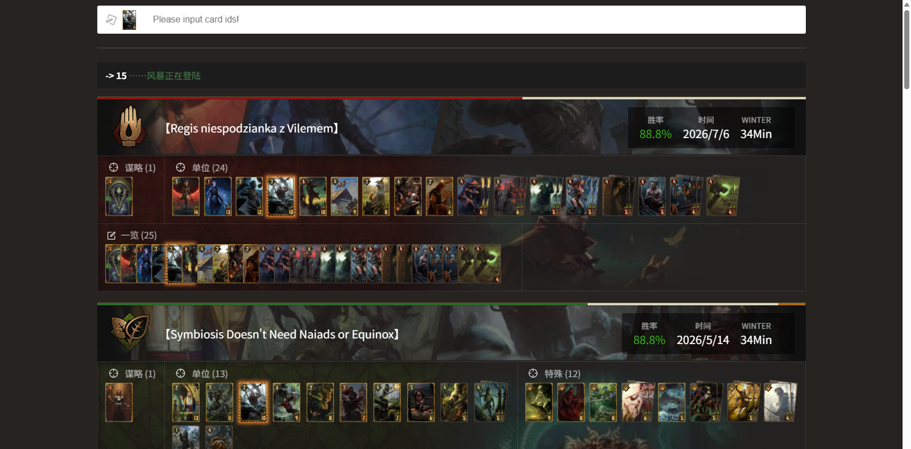
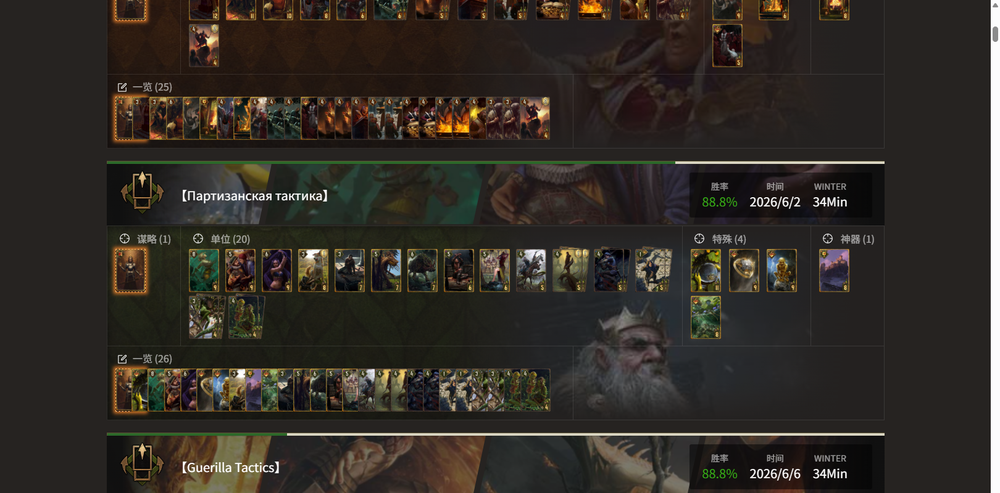
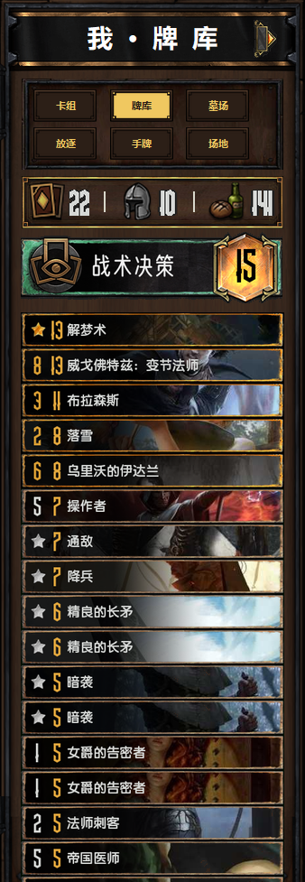
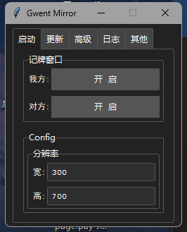

# 截图

全部截图来自真实运行（`docker run` 起容器 + `desktop/gui_demo.py` 渲染），不是设计稿。

## 前端

**卡组检索首页**：顶部卡牌检索栏 + 随机推荐的 50 套近期卡组，每个卡组按 谋略/单位/特殊/神器 分组展示。



**卡牌检索栏 + 悬浮卡牌详情**：点输入框展开卡牌下拉（虚拟列表），鼠标悬停任意卡牌会浮出带技能描述的大图。
注意卡牌名/技能来自内置 `allCard.json`，卡面素材来自 `/src/assets/card/`，全程不依赖官网接口。



**按卡牌过滤卡组**：选中「Geralt of Rivia」后，顶部显示命中数量（`-> 15`），
每个卡组的「一览」里被选中的那张牌会带橙色虚线边框。



**卡组详情**：按 谋略 / 单位 / 特殊 / 神器 分组，底部「一览」按人口降序排；背景是该势力的原画。



## 桌面记牌器（GwentWanHuaMirror）

对局中常驻的**透明置顶悬浮窗**：标题是当前页签（我·牌库 / 我·卡组 / 手牌 / 墓场…），
第二行是页签按钮，第三行是统计（剩余张数 / 单位数 / 总人口），
再往下是领袖卡与整副牌逐张排列（卡图 + 人口 + 战力 + 稀有度），新出现的牌会有高亮描边。



主控制窗（启动/更新/高级/日志/其他，含记牌窗开关与分辨率设置）：



> 这两张是用 `desktop/gui_demo.py` 在本机**实际渲染**出来的：界面代码、
> 资源图（`GwentImg_preview` / `deck_preview`）、字体全部走仓库原始实现，
> 只把「读 Gwent.exe 进程内存」这一层换成了替身数据源（见 [usage.md](usage.md#桌面记牌器界面复现)）。

## 动图

站点操作录屏（42 帧，5.8 MB）：`docs/gif/GwentMirror_Web.gif`，README 首屏引用的就是它。

## 图片为什么用相对路径

仓库内相对路径在 GitHub 上会被 camo 代理，在本地 `git clone` 后也能直接看，两边都对得上。
如果国内访问 GitHub 图片慢，可临时换成 jsDelivr 直链：

```markdown

```

仓库里的原图保持不动，只改 README 里的引用即可。